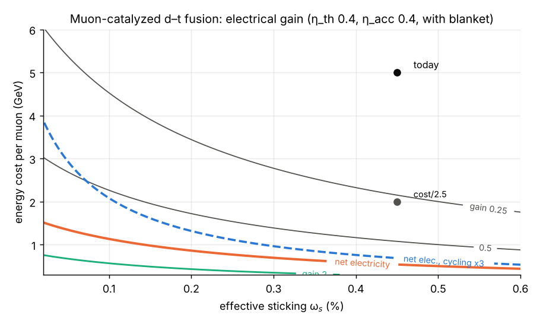
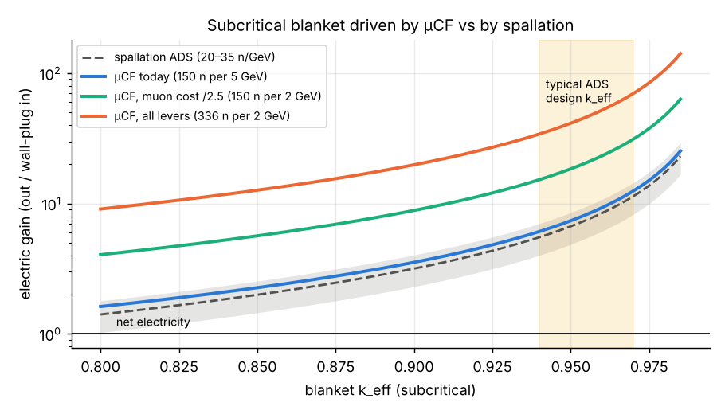

# 1. Starting point

A muon in a d–t mixture catalyses fusions at the cycling rate $\varphi\lambda_c$ until it decays or sticks to an alpha particle (probability $\omega_s$ per fusion), so the number of fusions per muon is $X = 1/(\lambda_0/\varphi\lambda_c + \omega_s)$. Calibrated to the measured $X\approx150$ at $\omega_s = 0.45\%$, the cycle model reproduces the published gains: $Q \approx 0.53$ from fusion alone, $0.67$ with lithium-blanket breeding heat, and an electric gain of $\approx0.11$ at 40% thermal and 40% accelerator efficiency (published: ~14%).

{width=6in}

# 2. Direct levers

| Scenario | Fusions per muon | Scientific Q | Electric gain |
|---|---|---|---|
| Today (5 GeV/μ, ω_s = 0.45%) | 150 | 0.67 | 0.11 |
| Muon cost /2.5 (2 GeV/μ) | 150 | 1.68 | 0.27 |
| Sticking halved | 226 | 1.01 | 0.16 |
| Cycling ×3 | 191 | 0.86 | 0.14 |
| Cost /2.5 + sticking /2 + cycling ×3 | 336 | 3.77 | 0.60 |
| … + better conversion (η_th 0.5, η_acc 0.6) | 336 | 3.77 | **1.13** |

No single lever is enough. Net electricity needs all four at once.

# 3. Subcritical blanket

Each fusion emits a 14.1 MeV neutron. In a blanket with $k_{\mathrm{eff}}<1$, a source neutron triggers $k/(\nu(1-k))$ fissions (3.6 at $k=0.90$, 7.6 at 0.95, 19.6 at 0.98), each releasing ~200 MeV. At $k_{\mathrm{eff}}=0.95$, a typical accelerator-driven-system design value, the electric gain becomes:

| Neutron source | Neutrons per GeV of beam | Electric gain at k_eff = 0.95 |
|---|---|---|
| Proton spallation on lead (ADS) | 20–35 | ~4–9 |
| μCF today | 30 | 7.4 |
| μCF, muon cost /2.5 | 75 | 18.5 |
| μCF, all direct levers | 168 | 41.3 |

{width=6in}

**Absolute gains are optimistic** (the multiplication formula ignores (n,2n), parasitic capture and leakage), but the comparison between sources is robust because the same blanket multiplies every source's neutrons equally. At $k_{\mathrm{eff}}=0.95$ the fusion itself supplies only ~1.1% of the heat. Tritium is not a constraint: each source neutron produces ~12 spare neutrons beyond those absorbed in fission, while breeding needs ~1 per fusion.

# 3.1 How cheap must muons get? (notebook 16)

We turn the question around and ask what beam energy per stopped muon, $E_\mu$, each goal allows. With today's cycle ($X \approx 150$), net electricity needs $E_\mu \approx 0.54$–$0.62$ GeV, 8–9× cheaper than today's ~5 GeV. That would take 1.6 stopped muons per GeV of beam, 23% of the ceiling set by the π⁻ rest mass. Cheaper muons alone are not a realistic route.

Using sourced scenarios: muon cost 5 GeV today, 2 GeV for Kelly et al. (2021) and 3.0 GeV for a simulated active-target source. Fusions per muon follow Yin et al. (2026): 148 unpolarised, 193 polarised and 300–350 for their "multi-technology synergy" case. At today's conversion efficiencies (0.4/0.4), no scenario reaches net electricity; the best supported case gives 0.58. With 0.5/0.6, a 2 GeV source at $X \approx 325$ reaches **gain 1.09**, and a 3.0 GeV active target with beam-heat recovery reaches 0.97. Both are at the threshold. Clear margin needs the extrapolated engineering-limit cycle ($X \approx 550$; gain 1.85 at 2 GeV).

Recovering beam heat from the pion-production target raises a 5 GeV source from 0.11 to 0.23. This is one ingredient of Kelly et al.'s 2.5× reduction, not an extra lever on top of it.

As a neutron source, μCF ties spallation today (break-even 5.4 GeV per muon). With polarised fuel it wins below 7.0 GeV per muon, so for waste burning the cycle measurements matter more than muon cost.

# 4. Conclusions

1. Pure μCF is ~9× from net electricity. Closing it directly needs cheaper muons, lower sticking, faster cycling and better conversion **together**.
2. A subcritical blanket gives net electricity with today's μCF numbers, but so does spallation, at the same neutrons per GeV. **μCF earns its place only once it out-produces spallation:** muons below ~4–8 GeV, or ≳100–175 fusions per muon.
3. The two numbers to watch are **muon production cost** (accelerator, pion-production target and capture design) and **effective sticking at high density** (MuFusE).
4. A μCF hybrid is a neutron-source technology. It carries the waste, licensing and safety profile of any accelerator-driven fission system.

**Reproducibility.** Notebooks 09, 10 and 16 at https://github.com/m1110/cold-fusion-gap. Inputs and their verification status: VERIFICATION.md (μCF data and muon cost at secondary/abstract level; spallation yield from GEANT4 studies, abstract-level).

**Acknowledgements.** Analysis and drafting assisted by an AI model (Claude, Anthropic).

# References (to be checked against primary sources)

- Jones S. E. et al., Phys. Rev. Lett. 56, 588 (1986): LAMPF μCF measurements.
- Kelly K. et al., J. Phys. Energy 3, 035003 (2021): muon production cost and μCF energy balance.
- Yin X., Kou W., Chen X., Muon-catalyzed nuclear fusion: physical mechanism, bottleneck breakthroughs and an engineering pathway, arXiv:2605.26432 (2026) (read in full).
- Parisi J. F., Rutkowski A., Isotope production in muon-catalyzed-fusion systems, arXiv:2511.20951 (2025) (read in full).
- Jändel M., Design principles for efficient muon production in muon-catalyzed fusion reactors, J. Fusion Energy 8, 81 (1989).
- MuFusE collaboration, arXiv:2606.05333 (2026): diamond-anvil cell for μCF at high density and temperature.
- GEANT4 studies of spallation neutron yield for ADS targets, Proc. IPAC 2016, TUPOY019.
