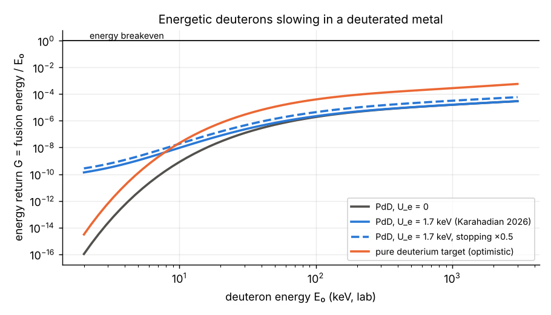

# 1. Energetic deuterons in deuterated metals

A deuteron of energy $E_0$ entering deuterated metal fuses with probability $P(E_0)=\int_0^{E_0} n_D\sigma(E)/|dE/dx|\,dE$ before stopping, and returns $G = P\langle Q\rangle/E_0$ of its energy ($\langle Q\rangle$ = 3.65 MeV). With Bosch–Hale cross-sections, a screening shift of up to 1.7 keV, and a Bethe-plus-low-energy stopping model for Pd (uncertain to ~2×):

| Case | Best energy return G | Orders below breakeven |
|---|---|---|
| PdD, no screening | 2.9×10⁻⁵ (at 3 MeV) | 4.5 |
| PdD, U_e = 1.7 keV (Karahadian et al. 2026) | 2.9×10⁻⁵ | 4.5 |
| PdD, 1.7 keV, stopping ×0.5 | 5.9×10⁻⁵ | 4.2 |
| Pure deuterium target (optimistic) | 5.7×10⁻⁴ | 3.2 |

{width=6in}

Screening multiplies the yield ×240 at 5 keV, but there G ~ 10⁻⁹. A deuteron loses its energy to electrons long before it is likely to fuse. **NASA's lattice confinement fusion (2020) and beam-loaded metals are therefore neutron sources and screening laboratories, not energy sources.** Avoiding electronic stopping requires recycling the energy in a hot plasma, which is thermonuclear fusion.

# 2. Catalysis

Muons work (~150 fusions per muon) but are ~9× from net electricity; the route to closing that gap is in the companion muon note. Pions and kaons decay too fast. A hypothetical long-lived heavy negative particle would catalyse fusion without decay losses, but none has been found.

# 3. Hot fusion and ignition

| Path | Status | Remaining gap |
|---|---|---|
| Laser ICF, d–t (NIF) | 8.6 MJ from 2.08 MJ laser, target gain 4.13 (2025) | ~3.6× in target gain to a facility with zero net demand (LLNL estimate ~15), plus laser efficiency and repetition rate |
| D–³He (Helion) | Polaris reported d–t fusion at 150 million °C (Feb 2026); D–³He needs ~200 million °C; ³He to be bred from d–d | D–³He plasma not yet reported |
| p–¹¹B, thermal | Fusion power exceeds bremsstrahlung by only a few % at best; alpha channeling could reduce the required confinement 2.6–6.9×; <2% ash prevents ignition | Marginal power balance |
| p–¹¹B, inertial | Breakeven needs ~100× current areal density at ~1000× pressure, with trapped bremsstrahlung | Far |
| p–¹¹B, laser-driven non-thermal | ~10¹¹ alphas per 600 J pulse; fusion energy ≈ 8×10⁻⁵ of laser energy | ~4 orders |
| p–¹¹B, dense plasma focus | >200 keV ion energies (deuterium); decaborane runs began 2025 | No p–¹¹B yield published |

# 4. Waste

| Option | Long-term hazard | Status |
|---|---|---|
| Once-through fission | Above uranium-ore radiotoxicity for ~300,000 years | Operating |
| Plutonium recycling | ~10,000 years | Operating |
| Partitioning and transmutation (fast reactors / ADS) | ~300 years | MYRRHA first phase slipped to 2027–2038 (reports of a freeze unconfirmed) |
| Thorium molten salt | Far fewer transuranics; fission products remain | TMSR-LF1 critical 2023; thorium→uranium conversion 2025; larger units ~2030 |
| d–t fusion | Activated structure; EU DEMO: ~10⁴ t intermediate-level waste 100 years after shutdown, mainly ¹⁴C | Design studies |
| D–³He / p–¹¹B fusion | Little / almost no activation | Not demonstrated |

**Fission cannot be made free of harmful products:** it always makes fission products. The best route shortens the hazard to centuries. Among nuclear options, only aneutronic fusion approaches "no harmful deposits", and it is the least developed.

# 5. Conclusions

1. No room-temperature path closes the gap within known physics. Energetic deuterons in metals fall 3–4.5 orders short of breakeven, independent of screening.
2. The paths with gaps of ~10× or less are **hot fusion** (laser and magnetic) and **muon catalysis**.
3. For low waste: partitioning and transmutation (fission, ~300-year hazard) is the nearest-term option; p–¹¹B is the cleanest but the furthest.

**Reproducibility.** Notebook 11 at https://github.com/m1110/cold-fusion-gap. Status levels of the literature inputs: hot-fusion and waste figures are from secondary sources and press releases (2025–2026) unless noted, to be checked against primary publications before citation.

**Acknowledgements.** Analysis and drafting assisted by an AI model (Claude, Anthropic).

# Sources (secondary unless noted; to be checked)

- Karahadian M. et al., Nat. Commun. 17, 8845 (2026), arXiv:2512.06212 (read in full).
- NASA Glenn lattice confinement fusion, Phys. Rev. C 101 (2020), two papers.
- LLNL NIF announcements (2025): 8.6 MJ, target gain 4.13.
- Helion Energy announcements (Feb 2026).
- Putvinski S. et al., Nucl. Fusion (2019), p–¹¹B power balance; Ochs I. E. et al., Phys. Plasmas (2024, 2026).
- Giuffrida L. et al., Phys. Rev. E 101 (2020): laser-driven p–¹¹B alphas.
- LPPFusion, Front. Phys. (2024); workshop presentation (2025).
- UKAEA studies of DEMO waste (Bailey et al., Nucl. Fusion 61, 036010, 2021).
- MYRRHA / SCK CEN publications (EPJ-N 2019, 2020); SINAP announcements on TMSR-LF1 (2025).
