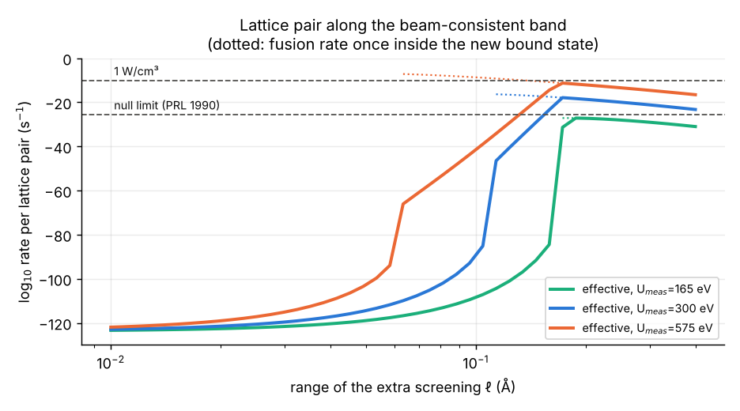
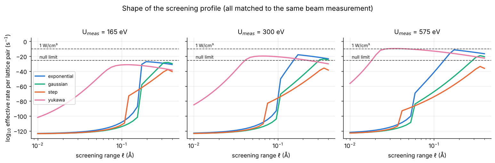

# 1. Introduction

Room-temperature fusion claims in deuterated metals [Fleischmann–Pons 1989; Jones et al. 1989] were met within months by molecular rate calculations [Koonin & Nauenberg 1989], general bounds on barrier penetration in many-body systems at equilibrium [Leggett & Baym 1989], estimates of conduction-electron screening [Parmenter & Lamb 1989], and null neutron searches [Aberdam et al. 1990]. A large re-examination found no evidence for the effect [Berlinguette et al. 2019].

One anomaly has since been firmly established by accelerator experiments. Fitted to low-energy d(d,p)t yields on deuterated metals, the **electron screening energy** is $U_e \approx 200$–800 eV in many metals [Raiola et al. 2002, 2004; Czerski et al.], against $\approx 25$ eV for D$_2$ gas targets and the $\approx 28$ eV adiabatic limit. Recent work found a 15% rate increase with electrochemical loading [Chen et al. 2025] and fitted $U_e = 0.8 \pm 0.2$ keV for beam-loaded Pd, rising to $1.7 \pm 0.2$ keV with electrochemical loading (Ti: 0.3 → 0.9 keV), together with a yield plateau below 2.5 keV [Karahadian et al. 2026]. The authors note that $U_e$ may lump several mechanisms, including depth-dependent loading and near-surface replenishment of deuterium.

All of these are **beam measurements**: they fix the effective potential near the classical turning point of keV deuterons, $R_{tp}\approx 0.004$ Å. They say nothing directly about deuterons at rest, 1–3 Å apart in the lattice. That is the regime any room-temperature effect would need. This paper asks: *if the anomalous screening extends to deuterons at rest, how far can it reach without contradicting the null searches, and what would it take to give practical rates?*

# 2. Method

## 2.1 Fusion rate of a bound pair

For a bound pair, the fusion rate is
$$\Gamma = A\,|\psi(0)|^2, \qquad A = \frac{S(0)\,c}{\pi\alpha\,\mu c^2},$$
with $S(0) = 109.3$ keV b (Bosch–Hale, both d+d branches), giving $A = 1.52\times10^{-16}$ cm$^3$ s$^{-1}$. $\psi$ is the s-wave ground state of the relative motion in potential $V(R)$. We solve $u'' = 2\mu(V-E)u$ on a logarithmic grid from 0.5 fm, starting from the regular repulsive-Coulomb solution, find the energy by node-counting bisection, and track amplitudes in log space ($\psi(0)$ is ~$10^{-37}$ of its peak).

## 2.2 Validation

With the Born–Oppenheimer curve of Pachucki [2010] ($R$ = 0.1–20 bohr), the solver reproduces:

| Quantity | This work | Reference |
|---|---|---|
| D$_2$ binding $D_0$ | 4.5559 eV | 4.5562 eV |
| HD / H$_2$ binding | 4.5133 / 4.4774 eV | 4.5139 / 4.4781 eV |
| d+d rate in D$_2$ | $2.0\times10^{-64}$ s$^{-1}$ | $3\times10^{-64}$ [Koonin–Nauenberg]; $5.7\times10^{-64}$ [2025 recalculation] |
| p+d rate in HD | $10^{-55.3}$ s$^{-1}$ | $\sim10^{-55}$ [Koonin–Nauenberg] |
| Thermal reactivity (Gamow integral) | within 1–2% | Bosch–Hale fit, 0.2–50 keV |

The solver is converged to 0.002 decades in step size and starting radius. The spread among published molecular rates (factor ~3) reflects nuclear-contact modelling; we take a factor of a few as the working uncertainty.

## 2.3 Lattice pair and anomalous screening

A lattice d–d pair is modelled by Thomas–Fermi-screened repulsion (0.57 Å for Pd) plus a restoring force on the separation set by the PdD optical phonon (37 meV), around an equilibrium spacing $d_0$. We use $d_0$ = 2.75 Å (octahedral neighbours) and also 1.4 and 0.94 Å, the average and minimum equilibrium separations reported for heavily loaded Pd [Sun & Tománek 1989; values as quoted in later reviews]. Variants with a barrier-capped restoring force, other screening lengths and phonon energies are in the repository.

The anomalous screening is an extra potential $\Delta V(R) = -\Delta U\,g(R/\ell)$ with four shapes: exponential, Gaussian, step and Yukawa-type ($g(x) = (1-e^{-x})/x$, which has a long $-q/R$ tail). For each range $\ell$, $\Delta U$ is fixed by requiring $\Delta V(R_{tp}) = -U_{\mathrm{meas}}$, so every model reproduces the beam data. When $\Delta V$ creates a new bound state at short range, the effective rate is the smaller of the bound-state fusion rate and the WKB tunneling rate into it from the lattice site.

# 3. Results

## 3.1 Baseline

A d–d pair at the lattice spacing fuses at $10^{-123.9}$ s$^{-1}$ (2.75 Å), $10^{-112.1}$ s$^{-1}$ (1.4 Å) and $10^{-109.5}$ s$^{-1}$ (0.94 Å). One watt per cm$^3$ of PdD requires ~$6\times10^{-11}$ s$^{-1}$ per pair, so the baseline gap is 98–114 orders of magnitude. For comparison, a D$_2$ molecule (0.74 Å) gives $2\times10^{-64}$ s$^{-1}$. Compressing a molecule-like pair, every hydrogen-isotope fuel except p+p reaches watt level at a spacing of 7.3–8.2 pm, corresponding to a screening particle ~9× heavier than an electron.

## 3.2 The cliff

{width=6in}

While the extra screening is confined to the region the beams probe, the lattice rate stays below $10^{-100}$ s$^{-1}$. As $\ell$ grows, the rate **jumps** when $\Delta V$ binds a new d–d state, at 0.24, 0.13 and 0.07 Å for $U_{\mathrm{meas}}$ = 165, 300 and 575 eV (exponential profile, 2.75 Å). It is then limited by tunneling into that state and by fusion within it ($10^{-27}$ to $10^{-7}$ s$^{-1}$).

## 3.3 Claim A: the range of anomalous screening at rest is bounded

The null neutron limit for Pd and Ti at rest [Aberdam et al. 1990] bounds $\ell$:

{{TABLE_A}}

{width=6in}

Across {{NVAR}} variants the allowed range is **{{RANGE}}**. It is set mainly by the profile shape and the Thomas–Fermi length; lattice stiffness, phonon energy and tunneling attempt frequency (×10$^{\pm3}$) change it by ≲20%, and closer equilibrium spacings tighten it. **For keV-scale screening with a long-tailed (Yukawa) profile, the bound reaches the beam turning point itself (~0.003–0.004 Å):** keV screening cannot extend appreciably beyond the distances the beam probes. (That Yukawa case also implies a long-range tail equivalent to ~0.75 e of screening charge per pair.) Step profiles and the weakest screening (165 eV) never reach the limit and remain unconstrained, but those cases also never come within 20 orders of watt level.

## 3.4 Claim B: watts imply neutrons

{{CLAIM_B}}

## 3.5 The neutron-free channel

p+d → ³He + γ (5.49 MeV) has no neutron branch, so the 1990 limit does not constrain it directly. With the same beam-consistent screening (up to 575 eV), the p+d lattice rate peaks at $10^{-12.3}$ s$^{-1}$, ~2.5 orders short of watt level even in a 50/50 H/D mix, and coexisting d+d pairs violate the neutron limit first. 1 W of p+d would also emit ~$10^{12}$ gammas per second. Disposing of fusion energy without any radiation would require the reaction energy to go directly into the lattice. For any process through the excited ⁴He compound nucleus, suppressing neutrons even by $10^{-3}$ requires a lattice decay width exceeding the 23.85 MeV transition energy, and coherent transfer is causality-limited (light travels <0.003 Å in the compound lifetime). We do not consider such channels further.

# 4. Relation to prior work

**Leggett & Baym [1989]** showed that, at equilibrium, the d–d tunneling rate is bounded by its Born–Oppenheimer value. Strictly, then, the anomalous screening cannot act on deuterons in equilibrium at rest at all. Our analysis is complementary. It does not assume equilibrium or a particular microscopic mechanism; it takes the *measured* beam anomaly at face value, allows it to extend to rest with an unknown range, and asks what the null searches allow. The answer, a range of order 0.01–0.3 Å and at most the beam turning point for keV screening, is an empirical constraint that holds even if the equilibrium assumption fails (e.g. under loading or irradiation). Leggett & Baym also argued that strongly reduced short-range repulsion would bind alpha particles to the metal more strongly; our short-range bound states (binding of order eV) would face the same thermochemical test.

**Czerski, Heide & Huke [2006]** extrapolated effective screening energies to cold-fusion energies and compared them with positive electrolysis claims; we instead model the range of the screening and confront it with null data. **Parmenter & Lamb [1989]** estimated ~$10^{-30}$ s$^{-1}$ from conduction-electron screening. **Huke et al. [2008]** and the Lipoglavšek group identified target and depth-profile effects in $U_e$ extraction, which motivate experiment E3. The sub-keV plateau of **Karahadian et al. [2026]** (>$10^{18}$ above bare-nucleus expectations at 0.25 keV beam energy) is not described by a constant $U_e$, as the authors note; our bounds use their fitted values above 2.5 keV.

# 5. Proposed experiments

**E1: gamma search for p+d fusion at rest.** A 10 g Pd foil co-loaded with H and D (0.45/0.45), with steady and cycled loading, a shielded HPGe/LaBr$_3$ detector with muon veto, and H-only, D-only and unloaded controls; 30 days. With assumed backgrounds this reaches ~$10^{-26}$ (surface) and $4\times10^{-28}$ (underground) per p–d pair per s, excluding screening ranges ≳0.12–0.16 Å for 300–575 eV in a channel the neutron searches did not cover.

**E2: heavy-fermion screening with a temperature switch.** d(d,p)t at $E_d$ = 5–30 keV on a deuterium-implanted heavy-fermion compound (Ce- or Yb-based) and its non-f analogue, at 4 K and 300 K, with in-situ depth profiling (ERDA). A "heavy-electron" origin of the anomaly predicts a large rise only below the coherence temperature; standard theory predicts no change. About 6 h per point at 10 μA.

**E3: same-target p+d vs d+d screening.** Alternating H$^+$/D$^+$ beams matched in stopping range on one deuterated target separate true electron screening (equal $U_e$), depth-profile artifacts (range-dependent) and a d+d-specific nuclear resonance ($U_e^{dd} > U_e^{pd}$). A 5σ answer needs ~2.6% p+d statistics, about 1.5 days per point at 1 mA.

# 6. Limitations

(i) The screening profiles are phenomenological; four shapes span short- and long-tailed behaviour but are not derived. (ii) The lattice pair is a single radial pair; anisotropy, many-body exchange and specific defect geometries are not modelled, although lattice stiffness and spacing affect the bound only weakly. (iii) The bound relies on one null measurement [Aberdam et al. 1990]; the weaker limit of Badurek et al. (3.6×10⁻²³) loosens it only slightly. (iv) Several literature inputs were verified at abstract level; the repository's VERIFICATION.md lists the status of each. (v) The p+d analysis was carried to 575 eV only.

# 7. Conclusions

1. Matching the measured beam screening (0.3–2.0 keV) and extending it to deuterons at rest, the null neutron searches bound its range to **{{RANGE}}**; for keV screening with a long-tailed profile, to the beam turning point itself.
2. In every model variant, rates approaching 1 W cm$^{-3}$ lie inside the region already excluded by the neutron searches: **watts imply neutrons.**
3. The anomaly is therefore either confined to short range (and irrelevant at rest), or it is something other than static screening, which experiments E1–E3 are designed to tell apart.

**Data and code availability.** Notebooks (03, 04, 04b reproduce every number here), the solver `cfsolve.py`, a claim-checking tool and figures: https://github.com/m1110/cold-fusion-gap

**Acknowledgements.** Analysis code and drafting were assisted by an AI model (Claude, Anthropic); all results are reproducible from the repository.

# References (to be completed and checked against primary sources)

- Aberdam D. et al., Phys. Rev. Lett. 65, 1196 (1990).
- Badurek G. et al. (1989), limits on d+d fusion in Pd and Ti.
- Berlinguette C. P. et al., Nature 570, 45 (2019).
- Bosch H.-S. & Hale G. M., Nucl. Fusion 32, 611 (1992) (and erratum).
- Chen K.-Y. et al., Nature 644, 640 (2025).
- Czerski K., Heide P. & Huke A., in Condensed Matter Nuclear Science (ICCF11), 228 (2006).
- Czerski K. et al., EPL 113, 22001 (2016).
- Huke A., Czerski K. & Heide P., arXiv:0805.4538 (2008).
- Jones S. E. et al., Nature 338, 737 (1989).
- Karahadian M. et al., Nat. Commun. 17, 8845 (2026), arXiv:2512.06212.
- Koonin S. E. & Nauenberg M., Nature 339, 690 (1989).
- Leggett A. J. & Baym G., Phys. Rev. Lett. 63, 191 (1989); Nature 340, 45 (1989).
- Pachucki K., Phys. Rev. A 82, 032509 (2010), arXiv:1007.0322.
- Parmenter R. H. & Lamb W. E., Proc. Natl. Acad. Sci. USA 86, 8614 (1989).
- Raiola F. et al., Eur. Phys. J. A 13, 377 (2002); 19, 283 (2004).
- Sun Z. & Tománek D., Phys. Rev. Lett. 63, 59 (1989).
- Zhou J. et al., Chin. Phys. Lett. (2006), d(d,γ)⁴He branching at 20 keV.
